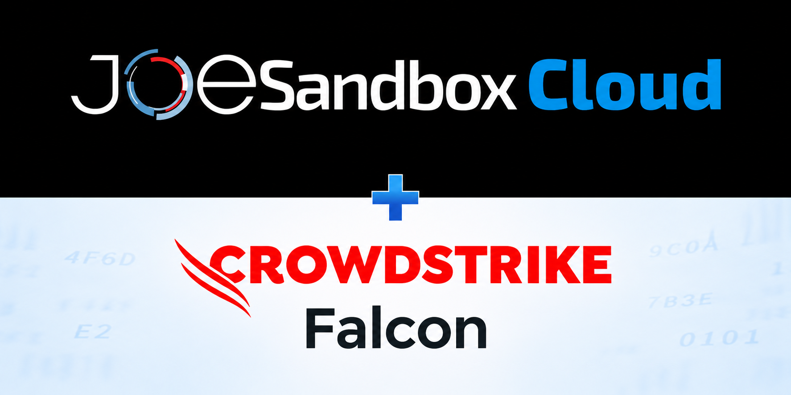
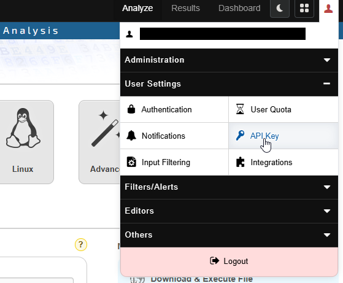
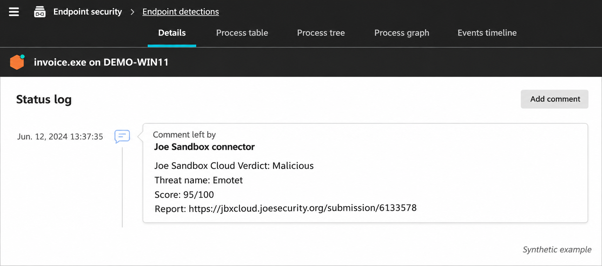

# Joe Sandbox Cloud for CrowdStrike Falcon

Investigate files associated with endpoint alerts directly in [CrowdStrike Falcon](https://www.crowdstrike.com/en-us/platform/endpoint-security/). The connector retrieves the file from Falcon, verifies its SHA-256, and submits it to [Joe Sandbox Cloud](https://www.joesecurity.org/joe-sandbox-cloud). By default, it also requests [Joe Reverser](https://www.joesecurity.org/joe-reverser) analysis when your account includes it. Once the analyses finish, the connector posts their overall verdict, reported threat names, the highest available score, and a link to the submission on the original Falcon alert.

## Requirements

- A CrowdStrike Falcon Insight XDR tenant and a user who can create API clients. In the Falcon console, open **Support and resources → Resources and tools → API clients and keys** and select **Add new API client**. Under **API scopes**, select the following permissions. [CrowdStrike credential setup](https://developer.crowdstrike.com/falcon-mcp/getting-started/credentials/)

  | API scope | Permission | Used by the connector to |
  | --- | --- | --- |
  | Alerts | Read | Find endpoint alerts and their file hashes. |
  | Alerts | Write | Post the analysis result as an alert comment. Required when `post_alert_comments` is enabled (the default). |
  | Sample uploads | Read | Download the file associated with an alert’s SHA-256. |

- A Joe Sandbox Cloud account with an API key that can submit files and read analysis results.
- A host with Docker Engine and Docker Compose, and outbound HTTPS access to both services.

## Install and start

1. From the connector directory, copy the configuration template.

   ```sh
   cp config.example.toml config.toml
   ```

2. In `config.toml`, enter the Falcon client ID, client secret, and your Falcon region’s API base URL under `[crowdstrike]`.

3. In Joe Sandbox Cloud, open **User Settings → API Key**. Enter the key as `cloud_api_key` under `[joe_sandbox]`. Keep the configuration readable by the container user (UID 10001) and private to your deployment.

   

### Start the connector

```sh
docker compose build
docker compose run --rm connector check-config
docker compose up -d connector
```

The configuration check validates local settings. The running service connects to both accounts. The Compose volume preserves alert history and pending submissions across restarts. Use a separate deployment and volume for each Falcon tenant.

## Verify the installation

1. Open a recent Falcon endpoint alert with a file SHA-256. In the connector logs, look for its Falcon alert ID and the Joe Sandbox submission ID.

   ```sh
   docker compose logs --tail=100 connector
   ```

2. With alert comments enabled, open that alert’s comments in Falcon after the analysis finishes. Look for **Joe Sandbox Cloud Verdict** and follow its report link. With comments disabled, open the submission in Joe Sandbox Cloud using the submission ID from the logs.

   

3. Under **Resulting analyses**, select **Full Report** for the sandbox or Joe Reverser analysis you want to inspect.

### Test without a Falcon tenant

From the connector directory, run the offline suite with Python 3.11 or newer, `requests`, and OpenSSL installed.

```sh
PYTHONPATH=src python3 -m unittest discover -s tests -v
```

The HTTPS test starts a [local Falcon mock](tests/falcon_mock.py) and uses a simulated Joe Sandbox result. It checks that two alerts referencing the same harmless file produce one submission and that each alert receives the expected comment when Joe Reverser finishes. You can run the mock separately with `python3 tests/falcon_mock.py --cert CERT.pem --key KEY.pem`. Use a certificate valid for `127.0.0.1`. The mock listens on port 8443 and accepts the test credentials `mock-client` and `mock-secret`. To inspect posted comments, send an authenticated GET to `/mock/comments`.

## Falcon alert comments

By default, the connector posts one comment for a completed result. For example:

```text
Joe Sandbox Cloud Verdict: Malicious
Threat name: Emotet
Score: 95/100
Report: https://jbxcloud.joesecurity.org/submission/6133578
```

If a connection breaks during a submission or comment, the service holds that operation to prevent duplicates. List interrupted operations with `docker compose run --rm connector review`. For a **sending** entry, search Joe Sandbox for the SHA-256 and the submission comment `CrowdStrike Falcon SHA-256 <hash>`. For a **posting** entry, check the alert’s comments. Stop the service before recording your decision:

```sh
docker compose stop connector
docker compose run --rm connector resolve ALERT_ID DECISION
docker compose up -d connector
```

Replace `DECISION` with the existing Joe Sandbox submission ID, or with `posted` if the Falcon comment arrived. Use `retry` only after confirming that the original operation did not succeed.

## Configuration options

### `[crowdstrike]`

| Option | Description |
| --- | --- |
| `base_url` | Falcon API URL for your tenant’s region. The default is US-1 (`https://api.crowdstrike.com`). |
| `client_id`, `client_secret` | Credentials for the Falcon API client. |
| `initial_lookback_hours` | How far back to search on the first start with an empty state volume. Default: 24 hours. |
| `post_alert_comments` | Defaults to `true`. Posts the completed analysis result on the original Falcon alert. Set to `false` to continue analyzing files and view results in Joe Sandbox Cloud without posting to Falcon. |

### `[joe_sandbox]`

| Option | Description |
| --- | --- |
| `cloud_api_url` | Joe Sandbox Cloud API address, including `/api`. |
| `cloud_api_key` | Key for submitting files and reading analysis results. |
| `report_base_url` | Customer-facing Joe Sandbox Cloud address used for the report links in Falcon. |
| `enable_reverser` | Defaults to `true`. Requests Joe Reverser alongside sandbox analysis. If your account does not include it, the connector continues with sandbox analysis alone. Set to `false` to disable it for new submissions. |

### `[connection]`

| Option | Description |
| --- | --- |
| `timeout_seconds` | Network request timeout. Default: 60 seconds. |
| `proxy_url` | Optional outbound HTTP or HTTPS proxy for both services. Empty uses direct connections. |

### `[service]`

| Option | Description |
| --- | --- |
| `poll_seconds` | Time between checks for alerts, files, and results. Default: 60 seconds. |
| `sample_wait_minutes` | How long to retry a file that Falcon reports as missing after the alert is first discovered. Default: 60 minutes. |
| `max_file_mb` | Maximum download size per file. The default is 200 MiB. |
| `database_path` | SQLite file for alert progress. The default, `/data/state.sqlite3`, is in the persistent Compose volume. |
